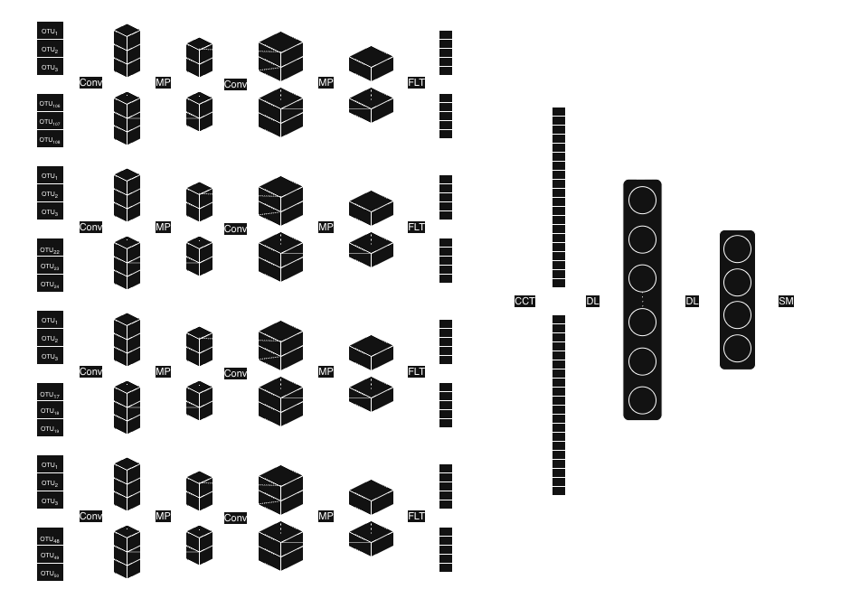

# Psychiatric Microbiome Pooled Analysis

This repository contains analysis code for a microbiome pooled analysis combining publicly available 16S rRNA sequencing data from studies of major depressive disorder (MDD), bipolar disorder (BD), schizophrenia (SCZ), and healthy controls. The project brings together data from multiple studies to examine microbial composition and diversity, compare microbial association networks, and explore whether genus-level profiles can distinguish the four groups.

The code covers several stages of the project, from sequence processing through statistical and machine-learning analyses. Input data, QIIME 2 artifacts, and visualizations associated with the analyses are also planned for inclusion to make the project easier to follow and reproduce. Some external reference files, such as the classifier and SEPP database, may still need to be obtained separately.

## Repository contents

| Path | Role in the project |
|---|---|
| `composition analysis/process.py` | Imports reads, demultiplexes when needed, trims primers/adapters, merges paired reads, and quality-filters sequences. |
| `composition analysis/denoise.py` | Runs Deblur, classifies sequences, merges studies, collapses taxonomy, and builds a SEPP phylogeny. |
| `composition analysis/analyze.py` | Runs rarefaction, diversity and group-significance analyses, or ANCOM-BC differential abundance on QIIME 2 artifacts. |
| `composition analysis/helpers.py` | Shared functions for the sequence-processing and composition scripts. |
| `Batch adjustment/Alpha diversity/` | Study-adjusted models for observed features, Faith's PD, Shannon diversity, and evenness. |
| `network analysis/sparcc.py` | Prepares shuffled group splits and calls FastSpar for six pairwise group comparisons. |
| `network analysis/network_analyze.py` | Builds thresholded association networks and compares network properties with permutations. |
| `machine learning/forest.py` | Random-forest classification from genus-level abundance data. |
| `machine learning/ensemble.py` | Four-branch convolutional neural-network classifier. |
| `machine learning/DNNhelpers.py` | Shared preprocessing, split, model, metric, and ROC-plotting functions. |

## Analysis overview

The main analysis path is to prepare per-study metadata and sequence inputs, process and denoise the reads, and then use the resulting QIIME 2 artifacts for diversity or differential-abundance analysis. Network and machine-learning scripts use separately prepared tables and are not connected automatically to the QIIME 2 outputs.

The scripts can also be used independently when their expected inputs are available. Commands below are examples; paths, parameters, metadata labels, and file layouts may need to be adapted to a particular analysis. Paths are generally relative to the current working directory.

## Sequence processing and composition analysis

### Software and input data

The sequence-processing scripts use the QIIME 2 Python API and plugins for demultiplexing, Cutadapt trimming, VSEARCH merging, quality filtering, Deblur, taxonomy classification, SEPP fragment insertion, diversity, and ANCOM-BC. The manuscript reports QIIME 2 2024.5.0. A compatible QIIME 2 environment with the required plugins is needed, along with the pretrained classifier and SEPP reference database artifacts used by `denoise.py`.

`composition analysis/helpers.py` reads a paper-metadata CSV with these column names:

| Column | Description |
|---|---|
| `name` | Study identifier used in output folders and filenames. |
| `layout` | `paired` or `single`. |
| `platform` | Sequencing platform; the code recognizes lowercase `illumina`. |
| `demuxed` | A non-empty value indicates already-demultiplexed reads; an empty value indicates multiplexed reads. |
| `sequencePath` | Path to a QIIME 2 `.qza` artifact, manifest, or sequence directory, depending on the input. |
| `fprimer`, `rprimer` | Forward and reverse primer sequences. |
| `ltrim`, `rtrim` | Integer left-trim and Deblur trim lengths. |

There is one row per study. The sequence import format depends on `layout` and `demuxed`, as implemented in `loadSequences()` in `helpers.py`.

The sample metadata is a QIIME 2 metadata TSV. A `Barcode` column is used when demultiplexing; a `Disease` column is used for group analyses. The disease values expected by the scripts are `BD`, `MDD`, `SCZ`, and `Healthy`.

### 1. Read preparation

From the `composition analysis` directory, the sequence preparation command is:

```shell
python3 process.py paper_metadata.csv sample_metadata.tsv output_dir
```

For each study, `process.py` imports the reads, demultiplexes multiplexed reads using the `Barcode` column, trims primers and adapters, merges paired reads, and applies QIIME 2's default `q_score` quality filter. Single-end reads skip merging. Artifacts and visualizations are written to `output_dir/<study>/`.

### 2. Denoising, taxonomy, and phylogeny

The denoising command uses the same paper metadata and an output root:

```shell
python3 denoise.py paper_metadata.csv genus classifier.qza sepp_reference.qza output_dir
```

The taxonomy level can be one of `kingdom`, `phylum`, `class`, `order`, `family`, `genus`, or `species`. The classifier and SEPP reference are QIIME 2 artifacts. This script applies Deblur using the per-study `ltrim` and `rtrim` values, classifies representative sequences, merges per-study tables/sequences/taxonomy, collapses the table to the selected level, and inserts sequences into the reference phylogeny with SEPP.

For this step, `sequencePath` in the paper metadata points to the sequences intended for Deblur, such as the filtered `.qza` output from `process.py`.

### 3. Diversity and differential abundance

`analyze.py` takes the merged SEPP tree, filtered feature table, taxonomy artifact, taxonomy level, sampling depth, maximum rarefaction depth, sample metadata, and output directory, in that order. For example:

```shell
python3 analyze.py SEPP-tree.qza filtered-table.qza taxonomy.qza genus 6000 12000 sample_metadata.tsv output_dir
```

A sampling depth of `0` selects alpha rarefaction up to the maximum depth. A positive depth runs QIIME 2 core phylogenetic metrics, saving alpha-diversity vectors, beta-diversity distance matrices and PCoA results, Emperor plots, and group-significance visualizations. The input table is then collapsed to the requested taxonomy level for ANCOM-BC differential-abundance analysis, which uses BH adjustment and a significance threshold of 0.001. The manuscript reports a primary sampling depth of 6,000 sequences per sample; the appropriate value depends on the table under analysis.

## Study-adjusted alpha-diversity models

The scripts in `Batch adjustment/Alpha diversity/` fit study-adjusted disease-versus-healthy models for observed features, Faith's PD, Shannon diversity, and evenness. They expect `metadata.tsv` and measure-specific TSVs with a response column named `Y` and metadata fields named `Study` and `Disease`. Sample IDs need to match between the measure and metadata tables.

The scripts use negative-binomial regression for observed features, beta regression for evenness, and HC3 robust linear models for log-transformed Faith's PD and Shannon diversity. They print model summaries and estimated marginal-mean comparisons. Relevant R packages include `MASS`, `betareg`, `estimatr`, and `emmeans`.

The R scripts use paths relative to the `Batch adjustment/Alpha diversity/` directory and no longer set a working directory themselves. From that directory, the four models can be run with `Rscript observed.R`, `Rscript faith.R`, `Rscript shannon.R`, and `Rscript evenness.R`. Some scripts contain row-position exclusions, which correspond to the input row order used in the analysis. The primary nonparametric alpha-diversity analysis described in the manuscript is not included in the current repository; these files cover the study-adjusted sensitivity models.

## Network analysis

### FastSpar inputs and permutation preparation

From `network analysis`, `sparcc.py` expects four tab-separated files at `raw/BD.tsv`, `raw/MDD.tsv`, `raw/SCZ.tsv`, and `raw/Healthy.tsv`. Each file has samples as rows and taxa as columns, with sample IDs in the first column. The script transposes these tables, intersects shared taxa for each group pair, combines the groups, and generates 1,000 shuffled splits for each of the six pairs. It calls the external [fastspar](https://github.com/scwatts/fastspar) executable and writes files under `permutations/<GroupPair>/counts/`, `cor/`, and `cov/`.

`INPUT_DIR`, `OUTPUT_BASE_DIR`, and `N_PERMUTATIONS` are configurable at the top of the file. FastSpar is expected to be available on `PATH`. The permutation run can generate many files and take considerable time.

### Network comparisons

`network_analyze.py` reads pairwise network data from `permutations/<GroupPair>/cor/`. Each pair directory contains observed group correlation tables named `<Group>.tsv` and permutation correlation tables named `<index>_1.tsv` and `<index>_2.tsv`. Pair names follow the combinations of `DISEASES` (`BD`, `MDD`, `SCZ`, `Healthy`). Results are written to `network_results/` by default; that directory needs to exist before the script runs.

From `network analysis`, the comparison command is:

```shell
python3 network_analyze.py
```

The script thresholds correlations at an absolute value of 0.3, constructs weighted graphs, and compares centrality and global network measures, hub overlap, community agreement, and graphlet correlation distance. It runs 1,000 permutation comparisons and applies BH correction to the measure and centrality p-values. Python dependencies include pandas, NumPy, SciPy, scikit-learn, NetworkX, [ORCA](https://github.com/qema/orca-py) bindings, and tqdm.

## Machine-learning classification

`forest.py` and `ensemble.py` expect a genus-level TSV named `genus.tsv` in the current working directory. Taxa are rows, samples are columns, and row labels contain taxonomic lineage strings. Sample IDs begin with a disease code recognized by `DNNhelpers.py`: `h`, `m`, `b`, or `s` for Healthy, MDD, BD, or SCZ, followed by a hyphen and a study identifier. The helper extracts the study from the second hyphen-separated field.

From `machine learning`, the model commands are:

```shell
python3 forest.py
python3 ensemble.py
```

The helper removes low-prevalence taxa, derives genus-level labels from lineage strings, orders features within Firmicutes, Proteobacteria, Bacteroidota, and other taxa using a correlation-based [TaxoNN-style](https://doi.org/10.1093/bioinformatics/btaa542) ranking, standardizes features, clips values to [-5, 5], and applies SVM-SMOTE to training data. `forest.py` fits a 250-tree random forest with 10 sample-level folds. `ensemble.py` fits a four-input convolutional network; its current study split uses IDs hard-coded in `DNNhelpers.py`. Both scripts print classification metrics and display one-vs-rest and one-vs-one ROC plots.

<figure style="text-align: center;">
    "
    <figcaption>CNN Ensemble Architecture</figcaption>
</figure>

The genus-level input table is not generated by the included scripts. Its preparation/export from a QIIME 2 table is a separate step. Python dependencies include pandas, NumPy, scikit-learn, imbalanced-learn, TensorFlow, and Matplotlib. The manuscript reports scikit-learn 1.6.1 and TensorFlow 2.21.0. The preprocessing and validation settings are specific to the current code and should be considered when interpreting model performance.

## Reproducibility and scope

Separate scripts for sensitivity analyses are not included to avoid duplicating code that reruns the main analyses on subsets of the data or with alternate parameter values. The manuscript describes those subsets and settings. For reproducibility, the input metadata, tables, QIIME 2 artifacts, classifier/reference artifacts, package versions, and parameters used for each analysis are useful companion materials. Some scripts also contain fixed labels, exclusions, and output folder names that reflect the original analysis.

Some analyses described in the manuscript, including beta-diversity sensitivity analyses and the full study-effect sensitivity analysis, are not implemented in the current repository. The scripts here therefore represent parts of the broader pooled analysis workflow rather than a complete reproduction package on their own.
